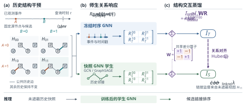

# 面向连续时间图链接预测的时序结构交互关系蒸馏

本文是《图神经网络关系知识蒸馏方法研究》的时序图方法章节底稿。研究对象是**从时序图神经网络教师向普通图神经网络学生迁移关系知识**。四视图交互蒸馏已完成实现与小规模训练检查。已有 TRD 与分数增量的实验用于说明研究动机，新方法的正式效果需由预定对照验证。

## 1. 研究背景与问题

连续时间图由按时间到达的交互事件构成。给定查询时刻的已观测历史，链接预测需要在多个候选目标中识别后续交互。时序 GNN 可以结合事件时间、顺序与历史邻域进行打分，普通 GCN 或 GraphSAGE 主要从当前历史快照的邻接关系中提取信息。二者的信息与表达差异，使直接模仿教师分数或节点表示无法回答学生究竟学到了什么关系知识。

先前方法对同一节点对比较两个历史前缀下的余弦关系。Wiki v2 的现有单种子结果中，GCN 上三个教师的平均 MRR 分别为 Logits KD 0.4669、原 TRD 0.4622。在 TGN→GCN 上，原 TRD 的正确、反向和零增量对应 0.4596、0.4669、0.4674。现有结果不足以支持指定增量方向带来收益。监督 SAGE 的 0.6535 已高于 TGN 的 0.6114，因此学生超过教师也不能作为关系知识成功迁移的独立证据。 [正式结果快照](EXPERIMENT_RESULTS.md) · [Wiki 消融与数据审计](docs/research/trd_wiki_analysis.md)

本章研究的问题是：**时序教师能否把多个历史证据如何共同改变候选链接相对关系的知识，迁移给只读取历史快照的普通 GNN？** 具体考察同一历史中两组已观察证据共同出现时，对一对候选链接的相对排序产生的非加性作用。

## 2. 蒸馏对象与论文主线

设 $u$ 为同一查询的源节点，$v,w$ 为两个候选。链接分数差 $R_M(u;v,w\mid H)=z_M(u,v\mid H)-z_M(u,w\mid H)$ 表示 $(u,v)$ 与 $(u,w)$ 的相对关系。给定两组可见历史证据 $A,B$，构造保留状态依次为 $(0,0),(0,1),(1,0),(1,1)$ 的历史视图。四个视图共享查询时刻、候选及其他历史。

以 Wiki 为例，$A=(u,a)$ 与 $B=(b,v)$ 单独存在时，历史中只能看到路径的一端。当二者与公共历史边 $(b,a)$ 同时存在，$u$ 和 $v$ 之间形成一条间接路径。两端共同出现是否改变 $v$ 相对 $w$ 的预测分数，由模型响应决定。

该关系对象可以写作：

$$
I_M=(R_M^{11}-R_M^{01})-(R_M^{10}-R_M^{00}).
$$

这里的「关系」有两个层次。第一层是**两个候选链接之间的相对偏好**。第二层是**两组历史证据对这一偏好的交互作用**。仅由节点身份产生的固定偏置和两组证据中可独立相加的作用会在差分中抵消。非零值表明模型对两组证据的响应存在非加性。邻居数量、度归一化与非线性解码也可能形成这种响应，因此还需与匹配随机证据组比较，检验真实路径的独立作用。

因此，本章的知识迁移目标可表述为：**让快照 GNN 保持时序教师在不同历史证据组合下的相对链接关系响应**。主张的对象是模型行为中的结构条件关系，现实交互的因果机制需要另行辨识。

> 图注建议：对同一查询遮蔽两组已观察历史事件，构造四种反事实输入。冻结的时序教师和快照学生分别计算候选链接的相对分数，按相同差分算子提取结构交互关系。训练对齐师生交互项并保留完整视图的链接监督。推理仅在正常历史快照上调用学生。

## 3. 方法设计和可迁移性

首先在预测时刻之前的固定邻域支持中选取两组局部证据。其次用同一候选对分别从时序教师与普通学生获得四种关系响应，构造 $I_T$ 和 $I_S$。最后在完整历史视图上训练链接预测，并附加 $\operatorname{Huber}(I_S-\operatorname{sg}(I_T))$。推理无需教师分数、历史干预或缓存的蒸馏目标。公式、共用事件约束和工程顺序见 [distillation_methods.md](distillation_methods.md)。

普通 GNN 前向对邻居排列不敏感，因而两个仅时间戳不同、邻接与静态输入完全相同的视图会产生相同输出。初期限定师生都观察到并且学生邻接确实改变的事件。即使结构可见，时序教师仍可能依赖额外的时间或消息信息。可检验的主张是**教师响应中能通过快照结构表达的部分可以迁移**，而非学生能够重建教师的完整时间机制。

本章计划贡献包括：

1. 将连续时间链接预测中的关系蒸馏对象从单节点对的一阶变化扩展为候选链接关系的四视图结构交互。
2. 将干预限制在普通学生实际能读取的历史结构，同时保持共同历史与查询条件固定，降低不可辨别监督的影响。
3. 在相同教师、学生、四种视图及候选预算下检验交互项是否带来独立增益，并按训练中已见和未见的节点对报告表现。

以上是拟验证的贡献表述。正式结论以同预算对照和多种子结果为依据。

## 4. 实验问题与证据标准

### 4.1 先验证教师目标是否值得蒸馏

首轮使用 Wiki v2 与 TGN→GCN。在训练前缀内构造基于三跳历史路径的证据组，记录合法查询覆盖率、$I_T$ 与 $I_S$ 的变化能量。若后续做机制辨识，可另采边数、事件新旧程度、端点度数和可见性尽量匹配的随机证据组。若目标普遍接近零，或真实路径与匹配随机组没有可区分的反应，应先审视证据组定义，再扩大训练规模。

### 4.2 主实验与机制对照

| 需要回答的问题 | 必要对照 | 解释标准 |
|---|---|---|
| 总体性能是否改善 | 监督学生、同教师 Logits KD、旧 TRD、`trd_score` | 同骨干和配对种子报告官方 MRR 差值 |
| 是否来自显式交互关系 | **同四视图 Logits KD**，每个视图分别对齐教师候选分布 | 匹配视图、候选、前向次数和训练预算 |
| 是否来自结构配对 | **匹配随机证据组**，仍计算四视图交互项 | 打断原定路径的证据组合，控制度数、时效和删除量 |
| 是否仅为正则 | 零目标、反向或打乱教师交互目标 | 保留四次前向，比较真实目标相对各控制的增益 |
| 是否超出身份记忆 | 训练已见/未见节点对分层，配套节点 ID 消融 | 依据训练集出现与否分桶，所有方法使用相同分桶 |
| 是否能跨模型迁移 | 增加 GCN 学生，并逐步复核 TGAT、TGN | 按各教师的可见性和状态重放协议判断可比性 |

当前正式计划包含四数据集的 TGN→GCN 主对比、只测试本文方法的三教师比较，以及 Wiki 上的真实与零目标消融。表中的同四视图 Logits KD、随机证据组等用于界定进一步归因需要的证据。每个正式组合使用三个配对种子和固定候选协议，按验证集选择超参数，测试使用 [TGB 固定负例与评价器](https://tgb.complexdatalab.com/docs/linkprop/)。全量与调试结果分开记录。详细范围见 [对比实验](comparison_experiments.md)。

### 4.3 支持与反证

若真实证据的交互蒸馏稳定优于同四视图 Logits KD、匹配随机证据组和零目标，才有证据把增益归于可迁移的结构交互关系。若性能改善只出现在训练中反复出现的节点对，应把结论缩小到对应的预测场景。若学生更接近教师的 $I_T$ 但 MRR 没有改进，则只能说明教师行为更易被复现，不能据此推断链接预测性能更好。

效率报告需包含参数量、每轮耗时、峰值显存、教师离线目标生成成本、学生前向和包含历史更新的端到端延迟。四视图增加训练成本，推理端的单前向并不能代替效率实测。

## 5. 与相关工作的关系

- **RKD** 从样本关系出发，用距离与角度进行师生对齐。本章也将关系作为基本蒸馏单元，但以候选链接的相对分数及其在历史结构变化下的交互作用定义目标。 [Relational Knowledge Distillation，CVPR 2019](https://openaccess.thecvf.com/content_CVPR_2019/html/Park_Relational_Knowledge_Distillation_CVPR_2019_paper.html)
- **TempME 和 CoDy** 提供时序基元与历史干预的直接参照。前者寻找支撑预测的时序基元，后者寻找能改变预测的反事实历史子图。本章把历史干预响应转化为师生可比较的关系目标，并在普通 GNN 上检验迁移。 [TempME，NeurIPS 2023](https://papers.neurips.cc/paper_files/paper/2023/hash/5c5bc3553815adb4d1a8a5b8701e41a9-Abstract-Conference.html) · [CoDy，ICML 2025](https://proceedings.mlr.press/v267/qu25b.html)
- **LightST** 是时空预测中的师生蒸馏参考，采用 GNN 教师与 MLP 学生。本章研究的是连续事件历史上的候选链接排序，采用快照 GNN 学生和四视图交互关系。框架图借鉴了师生双流布局。 [LightST，AAAI 2025](https://ojs.aaai.org/index.php/AAAI/article/view/32096)

应将论文新颖性落在「面向候选链接关系的结构交互目标」「时序到快照的可见性约束」和「等视图预算下的迁移检验」上，继续核查直接近邻方法，再决定贡献边界。

## 6. 当前状态和后续顺序

现有代码已支持四视图历史遮蔽、结构交互损失和配对零目标。合成数据和 Wiki 小前缀已验证训练链。尚无四个数据集的正式 MRR 或效率结果。

正式运行前先检查各数据集合法路径率与资源容量。完成主实验和零目标消融后，再根据结果决定是否增加同四视图 Logits KD 与匹配随机路径诊断。配套工程规范见 [distillation_methods.md](distillation_methods.md)。
