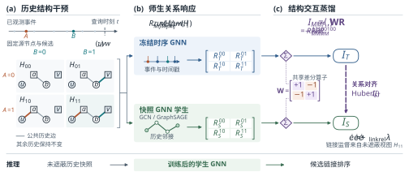

# 面向连续时间图链接预测的时序结构交互关系蒸馏

本文定义方法的蒸馏对象、历史干预协议、训练目标及工程验收条件。当前四视图方法已接入 `--method structure_interaction`。实验动机见 [METHOD_RESEARCH.md](METHOD_RESEARCH.md)，正式矩阵与已执行验证见 [comparison_experiments.md](comparison_experiments.md)。

## 1. 查询、教师和学生

在连续时间交互流中，查询记为 $q=(u,\mathcal C_q,t_q)$，其中 $u$ 为源节点、$\mathcal C_q$ 为目标候选集合。已观测前缀 $H_q$ 包含打分前允许读取的真实交互。模型为候选 $x\in\mathcal C_q$ 输出链接分数 $z_M(u,x\mid H)$，其中 $M\in\{T,S\}$ 分别表示教师和学生。教师在蒸馏期间冻结，主实验使用 TGN。学生使用至少两层的普通快照 GCN，输入为有界历史邻接和静态节点输入，可含配置允许的节点 ID 表示。

固定同一查询的候选 $v,w\in\mathcal C_q$，定义两条候选链接之间的相对关系：

$$
R_M(u;v,w\mid H)=z_M(u,v\mid H)-z_M(u,w\mid H).
$$

若候选分布由 softmax 产生，$R_M$ 等于两候选概率的对数比。该定义直接对应排序偏好，对给同一查询的所有候选分数加相同常数不敏感。师生可以使用不同的嵌入维度和边解码器。首轮可令 $v$ 为训练正例，从该查询的既定候选中为 $w$ 选择参照，两个候选在四个视图间固定。监督标签只用于训练损失与训练样本选择。

## 2. 同一历史上的四种视图

在 $H_q$ 中选择两组互不重叠的已观测事件 $A,B$，并记 $H_{00}=H_q\setminus(A\cup B)$。用原始事件 ID 标识事件，保留时间戳、方向和多次交互。四种视图只改变指定事件是否可见：

| 视图 | $A$ | $B$ | 可见历史 |
|---|---|---|---|
| $H_{00}$ | 隐藏 | 隐藏 | $H_q\setminus(A\cup B)$ |
| $H_{01}$ | 隐藏 | 保留 | $H_{00}\cup B$ |
| $H_{10}$ | 保留 | 隐藏 | $H_{00}\cup A$ |
| $H_{11}$ | 保留 | 保留 | $H_q$ |

表中的集合记号表示按原事件顺序过滤，不能把重新加入的事件追加到查询之前。四个视图共享查询时间、节点与候选顺序、原始边特征以及其他历史。$H_{11}$ 是当前训练协议下的完整可见视图。

首轮在 Wiki 二部图上使用 $u-a-b-v$ 的三跳历史路径。$a,v$ 为目的节点，$u,b$ 为源节点。将端点历史事件 $(u,a)$ 与 $(b,v)$ 分别记作 $A$ 与 $B$，公共历史事件 $(b,a)$ 始终保留。$v$ 是目标候选，$w$ 是参照候选。三跳路径的两端可分别通过源节点与候选节点的局部感受野影响评分；提取时须检查路径确实落在两端得分所依赖的快照中。该示例只要求事件在查询前已观察，路径边更严格的内部时间顺序属于可另行定义的实验条件。

### 可见性与状态隔离

- **观测边界**：首轮复用现有批前缀协议，先对查询批打分，再写入该批正边。相同时间戳跨批事件按固定事件索引处理。若另做严格 $t_e<t_q$ 的评估，需按相同时间戳分组，并为所有对照使用同一规则。
- **限定干预范围**：先在完整视图锁定学生最近 $K$ 次交互的邻居支持，再选择师生均可读取、对候选关系有结构意义的事件。计算遮蔽视图时从锁定的支持中移除对应事件，不用更旧的边补位。其余历史及候选保持一致。若多个事件映射到同一对节点，须验证遮蔽在学生的实际消息图上可见。
- **时序教师**：固定教师权重、绝对查询时间和时间归一化尺度。当前三教师均采用显式邻居读出干预。TGAT 与 GraphMixer 在锁定槽中遮蔽，TGN 在保持循环记忆不变时过滤显式邻居消息。若要撤销历史事件写入 TGN 记忆的影响，需另行实现按合法公共状态重放。
- **学生状态**：由同一完整快照构造临时分支，四次计算共用相同权重。分支不修改主事件缓存。若两份邻接与静态输入完全相同，普通学生应给出相同响应。
- **有效查询**：只有确有合法路径、候选配对和可见事件的查询进入关系项。其他查询仍保留正常的链接监督。应记录有效样本数和覆盖率，避免只报告挑选出来的子集。

## 3. 结构交互关系与目标函数

记 $R_M^{ij}=R_M(u;v,w\mid H_{ij})$。对同一个模型比较「存在 $B$ 时加入 $A$」和「不存在 $B$ 时加入 $A$」，得到结构交互关系：

$$
\begin{aligned}
I_M(q,A,B,v,w)
&=(R_M^{11}-R_M^{01})-(R_M^{10}-R_M^{00})\\
&=R_M^{11}-R_M^{10}-R_M^{01}+R_M^{00}.
\end{aligned}
$$

按行 $i$ 与列 $j$ 摆放四种视图，令

$$
\mathbf R_M=
\begin{bmatrix}R_M^{00}&R_M^{01}\\R_M^{10}&R_M^{11}\end{bmatrix},
\qquad
\mathbf W=\begin{bmatrix}+1&-1\\-1&+1\end{bmatrix},
\qquad
I_M=\langle\mathbf W,\mathbf R_M\rangle_F.
$$

若 $R_M^{ij}=c+\alpha i+\beta j$，则 $I_M=0$。此时两组历史的影响可相加。非零 $I_M$ 表示一组证据改变了另一组证据对候选相对关系的作用。正值表示相对于可加基线更偏向 $v$，负值表示更偏向 $w$。这是冻结模型对历史输入干预的响应，不能单独用来断言现实世界中的因果效应。

设 $\mathcal B$ 为查询批，$\mathcal P_{\mathcal B}$ 为合法的查询与证据元组集合，以 Huber 损失作为首轮实现：

$$
\mathcal L_{\mathrm{link}}
=\frac{1}{|\mathcal B|}\sum_{q\in\mathcal B}
\operatorname{CE}\!\left(z_S(q;H_{11}),y_q\right),
$$

$$
\mathcal L_{\mathrm{rel}}
=
\begin{cases}
\displaystyle
\frac{1}{|\mathcal P_{\mathcal B}|}\sum_{\xi\in\mathcal P_{\mathcal B}}
\operatorname{Huber}_{\delta}\!\left(I_S(\xi)-\operatorname{sg}(I_T(\xi))\right),
& |\mathcal P_{\mathcal B}|>0,\\[6pt]
0, & |\mathcal P_{\mathcal B}|=0.
\end{cases}
$$

$$
\mathcal L=\mathcal L_{\mathrm{link}}+\lambda\mathcal L_{\mathrm{rel}}.
$$

教师分支停止梯度。四个学生响应均使用当前学生权重并保留梯度，最后进行一次参数更新。普通 Logits KD 可作为对照或另设组合消融。若在方法中叠加 Logits KD，应给匹配对照同样的 KD 损失与权重，使关系项的独立贡献可识别。$\lambda$ 与 $\delta$ 待验证集选择，当前没有最优系数的实测结论。

## 4. 训练到推理的执行顺序

1. 生成当前查询批的候选，锁定正例位置、候选对、可见历史截止及模型的原始邻居支持。
2. 在查询前缀内选择合法 $A,B$，得到共享背景和四份临时遮蔽。缺少合法证据的查询仅在 $H_{11}$ 上做链接监督。
3. 时序教师、快照学生在四个视图上计算同一对候选的相对关系，分别构建 $\mathbf R_T,\mathbf R_S$。当前完整候选的批次链接监督与逐查询候选对的四视图前向分别计算。
4. 计算教师与学生的结构交互项，按上述目标更新学生。教师没有优化器更新。未来如缓存教师目标，缓存键应包含教师 checkpoint 哈希、数据版本、历史截止、候选及遮蔽事件 ID。
5. 丢弃临时视图。只有主事件流的真实已观察边能更新历史状态。
6. 验证与推理仅在正常未遮蔽快照上使用训练后的学生。每批只走普通学生的前向，缓存构建、更新和候选打分仍计入端到端成本。

## 5. 代码接口和验收

| 职责 | 共用接口 | 四视图实现 |
|---|---|---|
| 数据、模型、评估和 checkpoint | [benchmark.py](benchmark.py)、共享的时序数据加载与 TGB 评估 | [四视图训练器](util/structure_interaction_training.py) |
| 普通快照学生 | [model/snapshot_gnn.py](model/snapshot_gnn.py) | 对同一锁定邻居支持执行临时事件遮蔽，并按视图重算度归一化 |
| 时序教师 | [model/graphmixer_teacher.py](model/graphmixer_teacher.py) 等 | 三种显式读出使用[历史遮蔽接口](util/history_mask.py) |
| 损失与对照 | [loss/paper_baselines.py](loss/paper_baselines.py) | [交互目标与零目标](loss/structure_interaction.py) |

验收须覆盖四视图的事件身份与顺序、加性响应抵消、候选分数平移不变性、学生分支梯度、教师冷冻和分支无缓存写入。验证和测试中不得构造依赖真实未来边的训练监督。现有对比矩阵及通用对照的执行说明见 [comparison_experiments.md](comparison_experiments.md)。

## 6. 图件与相关工作

框架图可用 [中文 SVG](figures/temporal_relation_framework/temporal_relation_framework_v2_zh.svg) 或 [英文 SVG](figures/temporal_relation_framework/temporal_relation_framework_v2_en.svg) 排版，绘图脚本为 [draw_framework_v2.py](figures/temporal_relation_framework/draw_framework_v2.py)。图中 Huber 损失表示拟议训练目标。RKD、TempME、CoDy 和 LightST 的方法与本章的关系见 [METHOD_RESEARCH.md](METHOD_RESEARCH.md#5-与相关工作的关系)。
